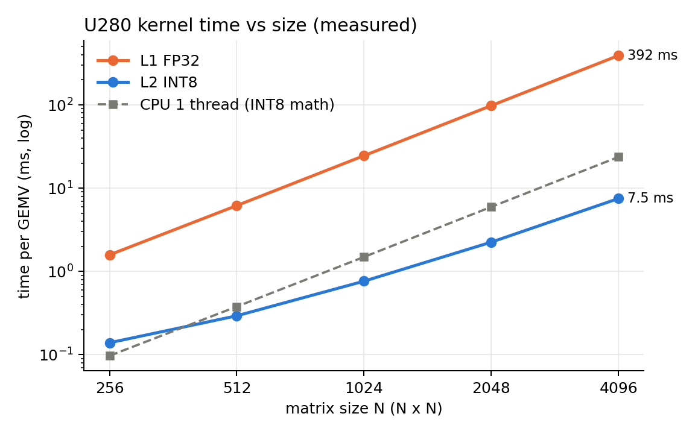
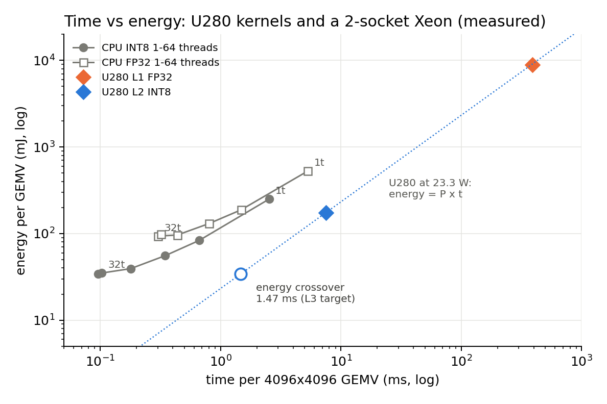
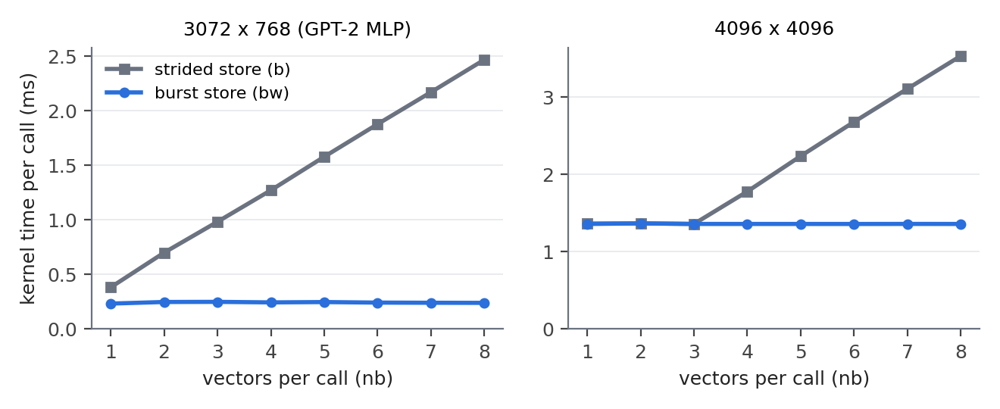

# Quantized GEMV for LLM Inference on the Alveo U280

EECE 5698 — FPGAs in the Cloud, Fall 2026

Shuozhe Zhou, Yifan Zhu

> **Project Update 2** (due 2026-11-24). The graded snapshot is branch
> [`project-update2`](https://github.com/shuozhezhou/gemv-u280/tree/project-update2);
> it does not change after the deadline. New in this update: accuracy metrics against
> the true result (section 7), a bit-width design-space exploration (section 8), where
> the input data comes from (section 3.1), who does what (section 11) and the code we
> started from (section 12). `main` keeps moving.
> The report for this update is
> [`reports/ProjectUpdate2-ShuozheZhou-YifanZhu.pdf`](reports/ProjectUpdate2-ShuozheZhou-YifanZhu.pdf).
>
> **After the deadline (Nov 24 evening)** we ran more experiments on the same two bitstreams:
> a size sweep from 256 × 256 to Llama-2-7B layer shapes, board power and energy per GEMV,
> a fitted cycle model, and a fair multi-threaded CPU baseline with RAPL energy (section 9).
> Supplement report:
> [`reports/ProjectUpdate2-Supplement-ShuozheZhou-YifanZhu.pdf`](reports/ProjectUpdate2-Supplement-ShuozheZhou-YifanZhu.pdf)
> (the submitted report plus sections 4.3 and 4.4).
>
> **Nov 25: L3 on the board and whole LLMs on the card** (section 10). L3 kernels at one
> 64-weight group per cycle (4096 × 4096 in 1.31 ms, below the CPU energy crossover; INT4 in
> 0.68 ms), up to 8 compute units after fixing an HBM-switch mapping problem (94 GB/s,
> 8.4 mJ per GEMV), GPT-2 small and Qwen3-0.6B running every linear layer on the U280
> (bit-exact, perplexity within 1% of FP32 with smoothing), and a batched kernel used for
> speculative decoding. The supplement report includes these results as section 4.4.
>
> Project Update 1 is frozen as branch and release
> [`project-update-1`](https://github.com/shuozhezhou/gemv-u280/tree/project-update-1).

## 1. Project summary

When a large language model generates text, every new token multiplies each weight
matrix by a single activation vector (GEMV, `y = W x`). Each weight is read once and
used for one multiply–add, so on a well-designed accelerator the speed is set by memory
bandwidth. Storing the weights as **INT8 with one FP32 scale per group of 64 weights**
cuts the bytes read by about 4× compared with FP32, at a small accuracy cost.

We are building a GEMV accelerator for this format on the **AMD Alveo U280** with
**Vitis HLS 2023.1**, on the Open Cloud Testbed (OCT). The problem size is
W = 4096 × 4096, one attention projection of a 7B model such as Llama 2.
Every design is checked against a software golden model **bit for bit**.

The work is split into layers; each starts from a design that passes all tests.

| Layer | Design | Status |
|---|---|---|
| L0 | Repository, file format, NumPy golden model, XRT host, tests | **done** |
| L1 | FP32 GEMV, one HBM channel, pipelined dot product | **done — bit-exact on the U280** |
| L2 | Group-wise INT8 weights (64 per group, FP32 scale) | **done — bit-exact on the U280, 52× faster than L1** |
| L3 | Partial sums for II = 1, dataflow, several HBM channels | **done — 1.31 ms, up to 8 CUs / 94 GB/s (section 10)** |
| L4 | INT4 kernel, real models, batching | **INT4 on the board; GPT-2 and Qwen3 end to end; batched kernel + speculative decoding (section 10)**. Llama-2-7B weights and GPU comparison not done |

## 2. What is implemented

Update 1 (L0 to L2):

- **Golden model and test data** (`scripts/gen_data.py`): fixed-seed inputs, the
  quantization, and golden outputs computed in float32 in exactly the order the
  kernels use, so results can be compared bit for bit. Corner cases (one-hot rows,
  all values ±127 = largest group sum, all-zero groups and rows), random cases,
  100 random small shapes, and three full 4096 × 4096 cases. MD5 checksums prove the
  large files regenerate identically on any machine.
- **L1 FP32 kernel** (`kernels/gemv_fp32.cpp`): x is copied into on-chip memory, then
  each row is a pipelined dot product. Passes csim, sw_emu, hw_emu and runs
  **bit-exact on the U280 at 4096 × 4096** (3 seeds), 300 MHz, 391.7 ms.
- **L2 INT8 kernel** (`kernels/gemv_int8.cpp`): one 512-bit HBM word = one group of
  64 int8 weights; 64 int8 multiplies + an int32 adder tree per cycle of the group
  loop, then one FP32 scale and accumulate. Passes csim, sw_emu (incl. 100 random
  shapes) and hw_emu, and runs **bit-exact on the U280 at 4096 × 4096** (3 seeds),
  300 MHz, 7.50 ms — **52× faster than L1**.
- **HLS C testbenches** (`tb/`), one per kernel, running all test cases.
- **XRT host program** (`host/host.cpp`): loads a test case, runs the kernel 100 times
  after a warm-up, reports kernel time, bandwidth and PCIe time, checks the output
  against the golden file, and runs the same computation on the CPU (single thread,
  same order of operations) as the software version / CPU baseline.
- **Makefile** for csim, csynth, sw_emu, hw_emu and hw, plus all logs and reports of
  our runs in `results/`.

Update 2 (no new kernel; measurements and analysis on the Update 1 designs):

- **Accuracy metrics** (`scripts/accuracy.py`): relative L2 error, max error, cosine
  similarity and SNR of the FP32 and INT8 outputs against the true result
  (float64, original weights), for all test cases (section 7).
- **Bit-width design-space exploration** (software): weights 8/6/4/3/2 bits ×
  group size 32/64/128/per-row, activations 8/6/4 bits (section 8).
- **Input data documented** (section 3.1) and **contributions / code sources**
  stated (sections 12 and 13).

After Update 2 (section 10):

- **L3 kernels** `gemv_int8_ps` (8 interleaved partial sums), `gemv_int8_fx` (fixed-point
  accumulation) and `gemv_int4_ps` (INT4), sharing the front end `kernels/int8_terms.h`;
  testbenches, sw_emu / hw_emu and board runs, all bit-exact against new golden models.
- **Multi-CU bitstreams** (2, 4, 8 CUs, `kernels/gemv_int8_ps_x*.cfg`) and a multi-CU host
  (`host/host_multi.cpp`).
- **Batched kernels** `gemv_int8_ps_b` and `gemv_int8_ps_bw`: one pass over W for up to 8
  activation vectors.
- **LLM driver** `host/llm_fpga.py`: GPT-2 / Qwen3 inference with every linear layer on the card,
  perplexity, SmoothQuant-style smoothing, batched perplexity and prompt-lookup speculative
  decoding.

## 3. Files

```
kernels/gemv.h            kernel interfaces (shared by kernels and testbenches)
kernels/gemv_fp32.cpp     L1 FP32 kernel
kernels/gemv_int8.cpp     L2 INT8 kernel
kernels/gemv_fp32.cfg     v++ link config: W -> HBM[0], x,y -> HBM[1]
kernels/gemv_int8.cfg     v++ link config: Wq -> HBM[0], s -> HBM[1], xq,y -> HBM[2]
kernels/int8_terms.h      L3 front end: one flattened loop over all 64-weight groups (II = 1)
kernels/gemv_int8_ps.cpp  L3a: 8 interleaved FP32 partial sums + adder tree (dataflow)
kernels/gemv_int8_fx.cpp  L3b: ap_fixed<48,24> accumulation
kernels/gemv_int4_ps.cpp  L3c: INT4 weights, 128 per 512-bit word
kernels/gemv_int8_ps_b.cpp, gemv_int8_ps_bw.cpp   batched L3a (up to 8 vectors per weight pass)
kernels/gemv_int8_ps_x{2,4,8}*.cfg   multi-CU link configs (*_aligned: banks behind each CU's switch)
kernels/gemv_dse.cpp      csynth-only bit-width / group-size DSE kernel
host/host_multi.cpp       XRT host for N CUs (rows split across CUs)
host/llm_fpga.py          GPT-2 / Qwen3 on the card (pyxrt), perplexity, speculative decoding
host/bench_batch.py       batched kernel: time and bit-exactness for 1..8 vectors
tb/tb_gemv_fp32.cpp       HLS C testbench, FP32 (tolerance 1e-6 x max|y|; all bit-exact)
tb/tb_gemv_int8.cpp       HLS C testbench, INT8 (bit-exact required)
host/host.cpp             XRT host program + CPU version
common/binio.h            file I/O and output comparison (host and testbenches)
scripts/gen_data.py       test inputs, quantization, golden outputs
scripts/check.py          compare an output file with the golden output; verify checksums
scripts/accuracy.py       accuracy against the float64 reference; bit-width sweep
scripts/hls.tcl           Vitis HLS csim / csynth / cosim script
data/FORMAT.md            data file format and quantization formulas
data/<case>/              committed small test cases: inputs + golden outputs
data/CHECKSUMS.md5        checksums of the generated 4096 x 4096 cases
results/                  our logs and reports (csim, csynth, sw_emu, hw_emu, hw_build, hw,
                          accuracy, dse, hw_sweep, hw_sweep_l3, multi_cu, gpt2, qwen3,
                          llm_on_fpga, spec_decode, l3/NOTES.md)
Makefile, env.sh          build/run commands and tool setup
```

**Inputs and golden outputs.** Each test case is a directory under `data/` with
`meta.txt` (M, K, seed) and raw little-endian binaries; `y_fp32.f32.bin` and
`y_int8.f32.bin` are the golden outputs. The six small cases are committed; the three
4096 × 4096 cases (82 MB each) and the 100 random small shapes are regenerated with
`make data`, which also verifies the checksums. See `data/FORMAT.md`.

### 3.1 Input data: where it comes from

All inputs are **synthetic** and made by `scripts/gen_data.py` with fixed seeds, so
anyone can regenerate exactly the same files:

- Weights: Gaussian with σ = 0.02 (the typical scale of LLM weight matrices), and
  0.1% of the entries multiplied by 10 as outliers. Real LLM weights have such
  outliers; they make the scales of different groups differ, which is the case
  group-wise quantization is designed for.
- Activation x: standard normal N(0, 1).
- Corner cases: one-hot rows (y[m] = x[col], checkable by hand), all values ±127
  after quantization (largest possible group sum), all-zero groups and rows.
- 100 random small shapes (`data/small/`, `--small 100`).
- Three 4096 × 4096 cases (seeds 1, 2, 3): the size of one attention projection
  of a 7B model such as Llama 2.

The large files are not committed; `make data` regenerates them and checks their
MD5 checksums (`data/CHECKSUMS.md5`). The checksums are identical on Windows with
NumPy 2.3.3 and on Ubuntu with NumPy 1.21.5. Real Llama-2-7B weights and recorded
activations are planned for the final phase.

## 4. Kernel interface

```cpp
// y = W x, W is M x K row-major, K a multiple of 64, K <= 4096
extern "C" void gemv_fp32(const float* W, const float* x, float* y, int M, int K);
extern "C" void gemv_int8(const ap_uint<512>* Wq, const float* s, const ap_uint<512>* xq,
                          float sx, float* y, int M, int K);
```

INT8 formulas (row m, group g of 64 columns):
`s = max|W|/127`, `Wq = clip(round_half_even(W/s), -127, 127)`,
`P[m][g] = Σ Wq·xq` (exact int32), `y[m] = sx · Σ_g s[m][g] · P[m][g]` (float32, g in order).

## 5. How to run

### 5.0 Tools and settings

| Item | Value |
|---|---|
| Target card | AMD Alveo U280 on the Open Cloud Testbed (OCT) |
| Platform | `xilinx_u280_gen3x16_xdma_1_202211_1` |
| Part | `xcu280-fsvh2892-2L-e` |
| Kernel clock | 300 MHz (3.33 ns): HLS clock in `scripts/hls.tcl`; v++ uses the platform's default 300 MHz kernel clock |
| Tools | Vitis / Vitis HLS 2023.1, XRT 2.15 on the card host |
| Host compiler | g++ (C++17) from the build VM |
| Python | Python 3 with NumPy (data generation, checks, accuracy) |

On OCT the tools and the FPGAs are on different machines:

| Machine | CloudLab profile | Used for |
|---|---|---|
| Build VM | `oct-build`, Tool Version **2023.1**, RAM 64 GB, 8 CPUs, no remote desktop | csim, csynth, sw_emu, hw_emu, hardware build, host compile |
| U280 node | `oct-u280`, Workflow **Vitis**, Tool Version **2023.1**, **Ubuntu 22.04**, no remote desktop; name a free node (see cluster status) | running on the card |

(The `oct-u280` nodes only have the XRT runtime; Vitis is not available there.)

### 5.1 Setup (build VM)

```bash
git clone https://github.com/shuozhezhou/gemv-u280.git && cd gemv-u280
sudo apt-get install -y python3-numpy      # NumPy is not preinstalled
source env.sh                              # Vitis 2023.1 + XRT; prints the platform
make data                                  # all test cases; ends with "CHECKSUMS PASSED"
```

### 5.2 C simulation and synthesis (build VM, about 1 minute each)

```bash
make csim   KERNEL=gemv_fp32      # all 6 small cases, expect "TEST PASSED"
make csim   KERNEL=gemv_int8
make csim   KERNEL=gemv_fp32 CSIM_CASES=data/n4096_rand_s1    # full size
make csynth KERNEL=gemv_fp32      # report: build/hls_gemv_fp32/sol/syn/report/csynth.rpt
make csynth KERNEL=gemv_int8
```

### 5.3 Software and hardware emulation (build VM)

```bash
make run KERNEL=gemv_fp32 TARGET=sw_emu CASE=data/n64_rand_s1      # ~1 min build
make run KERNEL=gemv_int8 TARGET=sw_emu CASE=data/n64_pm127_s1
make run KERNEL=gemv_fp32 TARGET=hw_emu CASE=data/n128_rand_s1     # ~9 min build, ~1.5 min run
```

Every run ends with `TEST PASSED` and prints how many outputs are bit-exact.

### 5.4 Accuracy and bit-width sweep (any machine with Python 3 + NumPy, a few seconds)

```bash
python3 scripts/gen_data.py          # if data/n4096_rand_s* are missing
python3 scripts/accuracy.py          # -> results/accuracy/accuracy_metrics.txt,
                                     #    results/dse/bitwidth_sweep.csv
```

### 5.5 Hardware

Build on the build VM (about 100 minutes):

```bash
make host
make xclbin KERNEL=gemv_fp32 TARGET=hw     # -> build/gemv_fp32.hw/gemv_fp32.xclbin
make xclbin KERNEL=gemv_int8 TARGET=hw     # -> build/gemv_int8.hw/gemv_int8.xclbin (~75 min)
```

Copy the repository including `build/gemv_host` and the `.xclbin` to the U280 node, then:

```bash
sudo apt-get install -y python3-numpy
python3 scripts/gen_data.py && python3 scripts/check.py --verify-checksums
source /opt/xilinx/xrt/setup.sh && unset XCL_EMULATION_MODE
xbutil examine                              # card must show "Yes" under Ready
./build/gemv_host build/gemv_fp32.hw/gemv_fp32.xclbin gemv_fp32 data/n4096_rand_s1 100
./build/gemv_host build/gemv_int8.hw/gemv_int8.xclbin gemv_int8 data/n4096_rand_s1 100
```

Arguments: `<xclbin> <kernel> <case_dir> [timed runs]`, kernel = `gemv_fp32`, `gemv_int8`,
`gemv_int8_ps`, `gemv_int8_fx` or `gemv_int4_ps`. The host writes
the output to `build/y_out.f32.bin`; `python3 scripts/check.py <case> build/y_out.f32.bin --kernel fp32`
checks it independently.

### 5.6 L3, several CUs and whole models (section 10)

```bash
make xclbin KERNEL=gemv_int8_ps TARGET=hw                     # also gemv_int8_fx, gemv_int4_ps
make xclbin KERNEL=gemv_int8_ps TARGET=hw NCU=8 TAG=_aligned  # kernels/gemv_int8_ps_x8_aligned.cfg
make xclbin KERNEL=gemv_int8_ps_bw TARGET=hw                  # batched kernel
make host_multi
# on the U280 node
./build/gemv_host_multi <xclbin> gemv_int8_ps 8 data/n4096_rand_s1 2000
python3 host/llm_fpga.py --model <gpt2 dir> --backend fpga --xclbin <xclbin> --kernel gemv_int8_ps \
    --cus 4 --smooth 0.5 --calib calib_text.txt --ppl ppl_text.txt --check
python3 host/llm_fpga.py --model <gpt2 dir> --backend fpga --xclbin <bw xclbin> --kernel gemv_int8_ps_bw \
    --smooth 0.5 --calib calib_text.txt --prompt "..." --tokens 128 --spec 7
python3 host/bench_batch.py <bw xclbin> 200 gemv_int8_ps_bw
```

Model directories hold the Hugging Face files (`model.safetensors`, `config.json`, `vocab.json`,
`merges.txt`) of `openai-community/gpt2` and `Qwen/Qwen3-0.6B`. The texts used for perplexity
and calibration are in `results/gpt2/`. `scripts/run_spec_board.sh` runs the speculative-decoding
experiment with board power sampling.

## 6. Results

### 6.1 Correctness

| Test | FP32 (L1) | INT8 (L2) |
|---|---|---|
| csim, 6 small cases | bit-exact | bit-exact |
| csim, 4096 × 4096 | bit-exact (3 seeds) | bit-exact |
| sw_emu, 7 cases + 100 random shapes | all pass, bit-exact | all pass, bit-exact |
| hw_emu (RTL simulation) | 3/3 bit-exact | 3/3 bit-exact (incl. the ±127 case) |
| **U280 hardware** | **9/9 cases bit-exact, incl. 3 × 4096 × 4096** | **9/9 cases bit-exact, incl. 3 × 4096 × 4096** |

Error of the outputs against a float64 reference with the original weights
(max |y − y_ref| / max |y_ref|, 4096 × 4096): FP32 1.6–2.2 × 10⁻⁶, INT8 0.98–1.35 × 10⁻²
(the cost of quantization).

### 6.2 L1 FP32 on the U280 (4096 × 4096, 100 runs, kernel time only)

| | Value |
|---|---|
| Kernel time | **391.66 ms** (min 391.66, max 391.68) |
| csynth prediction | 117,489,813 cycles × 3.33 ns = 391.63 ms |
| Data read / bandwidth | 64 MiB / **0.17 GB/s** (≈1.2% of one HBM pseudo-channel) |
| Host → device copy (PCIe) | 16.8 ms for 64 MiB |
| Kernel clock | 300 MHz achieved (timing met, WNS +0.014 ns) |
| Kernel resources (post-route) | 3,514 LUT, 4,301 FF, 8 DSP, 2 BRAM, 1 URAM (≈0.3%) |
| CPU, 1 thread, same op order (Xeon Gold 6226R) | 54.5 ms |

**Why L1 is slow — the initiation interval.** The inner loop is
`acc += W[m][k] * x[k]`. Each addition needs the result of the previous one, and an FP32
adder at 300 MHz takes 7 cycles (`fadd_32ns_32ns_32_7` in the report). So a new
iteration can only start every 7 cycles: **II = 7** (HLS tried II = 1…6 and reported a
carried-dependence violation for each). One row takes 4096 × 7 + 14 cycles, the whole
matrix 117.5 M cycles, which matches the measured time to 0.01%. The kernel reads only
4 bytes every 7 cycles, so it is limited by this dependence chain, not by memory, and is
about 7× slower than one CPU core. L2 and L3 address exactly this.

### 6.3 L2 INT8 on the U280 (4096 × 4096, 100 runs, kernel time only)

| | Value |
|---|---|
| Correctness | **bit-exact** (tolerance 0) for 3 seeds at 4096 × 4096 and all 6 small cases |
| Kernel time | **7.50 ms** (min 7.50, max 7.52) |
| csynth prediction | 2,244,753 cycles × 3.33 ns = 7.48 ms |
| **Speed-up over L1** | **52×** (391.66 ms → 7.50 ms; proposal target ≥ 3×) |
| Data read / bandwidth | 17 MiB (16 MiB weights + 1 MiB scales + 4 KiB x) / **2.38 GB/s** |
| Host → device copy (PCIe) | 4.3 ms for 17 MiB |
| Kernel clock | 300 MHz achieved (timing met, WNS +0.016 ns) |
| Kernel resources (post-route) | 6,371 LUT, 8,597 FF, 71 DSP, 38 BRAM (≈0.5% LUT) |
| CPU, 1 thread, same op order (Xeon Gold 6226R) | 23.7 ms → the FPGA kernel is 3.2× faster |

**Why 52× with the same II.** The group loop still has II = 7, because the FP32
accumulate `acc += s·P` still depends on itself. But one iteration now consumes a whole
512-bit word, 64 weights, through 64 int8 multipliers and an int32 adder tree, instead of
one weight. 4096 × 64 groups × 7 cycles ≈ 1.8 M cycles plus per-row overhead ≈ 2.24 M
cycles, against 117.5 M for L1. At 2.38 GB/s the kernel still uses only about 16% of one
HBM pseudo-channel, so it is still limited by the FP32 add chain — the target of L3.

## 7. Accuracy against the true result

Bit-exactness says the hardware computes exactly what the golden model computes. It
does not say how close that is to the correct answer. `scripts/accuracy.py` compares
the outputs with `y_ref.f64.bin`, the product W x computed in float64 from the
original (unquantized) weights. The U280 outputs are bit-identical to the golden files
(section 6.1), so **these are also the accuracy numbers of the hardware**.

Metrics: rel. L2 = ‖y − y_ref‖ / ‖y_ref‖; max rel. = max |y − y_ref| / max |y_ref|;
cosine similarity; SNR = 20 log10(‖y_ref‖ / ‖y − y_ref‖).

| Case (4096 × 4096) | Kernel | rel. L2 | max rel. | cosine | SNR (dB) |
|---|---|---|---|---|---|
| seed 1 | FP32 | 1.145e-06 | 1.610e-06 | 1.00000000 | 118.83 |
| seed 1 | INT8 | 1.139e-02 | 9.807e-03 | 0.99993526 | 38.87 |
| seed 2 | FP32 | 1.140e-06 | 1.932e-06 | 1.00000000 | 118.86 |
| seed 2 | INT8 | 1.219e-02 | 1.173e-02 | 0.99992574 | 38.28 |
| seed 3 | FP32 | 1.173e-06 | 2.245e-06 | 1.00000000 | 118.62 |
| seed 3 | INT8 | 1.227e-02 | 1.350e-02 | 0.99992467 | 38.22 |

The small cases are in `results/accuracy/accuracy_metrics.txt` (INT8 rel. L2
6.2e-03 to 1.3e-02; the ±127 case is exact up to float32 rounding because every value
is representable). FP32 error is float32 rounding only (about 1e-6). INT8 costs about
1% relative error, SNR about 38 to 39 dB, cosine 0.99993.

## 8. Design-space exploration: bit widths

Software sweep on `n4096_rand_s1` (`scripts/accuracy.py`, full table in
`results/dse/bitwidth_sweep.csv`). Weights are quantized to b bits with one FP32 scale
per group (symmetric, qmax = 2^(b−1) − 1, round half to even), the activation to 8 bits
as in the kernel. Bytes per weight = b/8 + 4/group; this is what a bandwidth-bound
kernel has to read, so it sets the best possible kernel time.

Relative L2 error (activation INT8):

| Weight bits | group 32 | group 64 | group 128 | per row (4096) |
|---|---|---|---|---|
| 8 | 1.05e-02 | **1.14e-02** (our L2) | 1.27e-02 | 3.48e-02 |
| 6 | 2.68e-02 | 3.29e-02 | 4.00e-02 | 1.37e-01 |
| 4 | 1.12e-01 | 1.38e-01 | 1.68e-01 | 5.49e-01 |
| 3 | 2.37e-01 | 2.76e-01 | 3.29e-01 | 8.47e-01 |
| 2 | 6.20e-01 | 6.88e-01 | 7.48e-01 | 9.50e-01 |

Bytes per weight: 8 bit 1.125 / 1.0625 / 1.031 / 1.001; 6 bit 0.875 / 0.8125 / 0.781 /
0.751; 4 bit 0.625 / 0.5625 / 0.531 / 0.501 (group 32 / 64 / 128 / per row).

Activation bits (weights 8 bit, group 64): 8 bit 1.14e-02, 6 bit 3.54e-02,
4 bit 1.54e-01. With the activation kept in FP32 the 8-bit g64 error drops to 7.6e-03.

What this shows:

- Per-group scales matter more and more as the bit width drops. At 8 bits, per-row
  scales cost 3× more error than groups of 64; at 4 bits per-row quantization is
  unusable (55% error) while groups of 32 to 64 give 11 to 14%.
- At 8-bit weights the 8-bit activation sets an error floor around 1e-2: smaller
  groups help little (1.05e-02 at g32 vs 1.14e-02 at g64).
- Plain round-to-nearest at 4 bits or below loses a lot of accuracy on this data.
  Real INT4 schemes (GPTQ, AWQ) add error compensation; we will test them on real
  Llama-2 weights. 6-bit g64 (0.81 B/weight, 24% fewer bytes than 8-bit g64, 3.3e-02
  error) is a possible middle point.
- This sweep is software only. Hardware runs at other bit widths are planned (L4).

## 9. Size sweep, power and a fair CPU baseline (Nov 24)

Same L1 / L2 bitstreams, node pc157. Every run below passed the bit-exact check (tolerance 0).
Scripts: `scripts/gen_sweep.py` (data), `scripts/run_sweep.sh` (board runs + power sampling with
`xbutil examine -r electrical`), `host/cpu_bench.cpp` + `scripts/run_cpu_bench.sh` (CPU baseline),
`scripts/analyze_sweep.py` (tables and figures). Raw logs and outputs: `results/hw_sweep/`.

| Shape (M × K) | L1 FP32 (ms) | L2 INT8 (ms) | INT8 GB/s | L1 / L2 |
|---|---:|---:|---:|---:|
| 256 × 256 | 1.582 | 0.139 | 0.50 | 11× |
| 512 × 512 | 6.179 | 0.293 | 0.95 | 21× |
| 768 × 768 (GPT-2 attention) | 13.834 | 0.506 | 1.24 | 27× |
| 1024 × 1024 | 24.548 | 0.763 | 1.46 | 32× |
| 3072 × 768 (GPT-2 MLP) | 55.194 | 1.910 | 1.31 | 29× |
| 2048 × 2048 | 97.987 | 2.245 | 1.99 | 44× |
| 4096 × 4096 (Llama-2-7B attention) | 391.669 | 7.500 | 2.38 | 52× |
| 11008 × 4096 (Llama-2-7B FFN gate/up) | 1052.505 | 20.084 | 2.39 | 52× |



**Cycle model** (`results/hw_sweep/cycle_model.txt`). A least-squares fit of
cycles = c0 + c_row·M + c_grp·(M·K/64) over the nine shapes: FP32 costs **7.00 cycles per
weight** (the fadd latency, II = 7; fit error 0.3%); INT8 costs **6.99 cycles per 64-weight
group** plus ~100 cycles per row and ~37 µs per call (fit error 4.5%). At II = 1 per group (L3)
the per-row cost would become the largest term for 4096 × 4096 unless rows overlap.

**Power and energy** (`results/hw_sweep/power_summary.txt`). Board power: 19.4 W shell only,
22.8 W with our xclbin loaded, 23.3 W while INT8 runs, 22.8 W while FP32 runs. The kernel adds
< 0.5 W, so energy ≈ static power × time. One 4096 × 4096 GEMV: **8.92 J (L1) vs 0.175 J (L2),
51× less energy**.

**Fair CPU baseline** (`results/hw_sweep/cpu_vs_fpga.txt`). The 23.7 ms CPU number in section 6
is a single-thread loop in the golden model's order. `host/cpu_bench.cpp` does the same INT8 math
with OpenMP + AVX-512 on the node's 2 × Xeon Gold 6226R, streaming W from DRAM (rotating copies of
more than 512 MiB), energy from RAPL (package + DRAM, both sockets).

| 4096 × 4096 GEMV | Time (ms) | Power (W) | Energy (mJ) |
|---|---:|---:|---:|
| U280 L1 FP32 (board) | 391.669 | 22.8 | 8918 |
| U280 L2 INT8 (board) | 7.500 | 23.3 | 174.6 |
| CPU INT8, 1 thread | 2.532 | 99 | 250.4 |
| CPU INT8, 8 threads | 0.346 | 161 | 55.6 |
| CPU INT8, 32 threads | 0.102 | 342 | 35.0 |
| CPU FP32, 32 threads | 0.300 | 311 | 93.5 |



The CPU is 70× faster than L2 (about 160 GB/s from DRAM vs 2.4 GB/s from HBM) but draws ~340 W.
At ~23 W the U280 matches the best CPU energy per GEMV once a 4096 × 4096 GEMV takes
**≤ 1.47 ms**. That is the L3 target; matching the CPU's time too needs ~160 GB/s, i.e.
weights spread over at least 12 HBM pseudo-channels.

**L3, first numbers (synthesis estimate only; board run pending).** Two new INT8 kernels
remove the II = 7 chain: `gemv_int8_ps` (8 interleaved FP32 partial sums + fixed adder tree)
and `gemv_int8_fx` (fixed-point `ap_fixed<48,24>` accumulation), with the rows × groups loop
flattened and a dataflow pipeline. Both pass C simulation bit-exactly against their own goldens
(7 small cases + 4096 × 4096, tolerance 0). Vitis HLS: **262,313 cycles for 4096 × 4096 =
0.874 ms at 300 MHz**, one 64-weight group per cycle with no per-row overhead, 8.6× fewer
cycles than L2. Expected on the board: ~1.2 ms (one HBM pseudo-channel ≈ 14.4 GB/s < 19.2 GB/s
needed), still below the 1.47 ms energy crossover. Hardware builds are running; the code will be
pushed with the board results.

**Llama-2-7B, one decode token** (`results/hw_sweep/llama7b_token_estimate.txt`):
32 layers × (4 × 4096² + 3 × 11008 × 4096) GEMVs = 151 s/token with L1, 2.9 s/token with L2
(~67 J/token on the board). The down projection (K = 11008) exceeds MAX_K = 4096 and is
counted at the gate/up time.

## 10. L3 on the board, INT4, several HBM channels, whole LLMs and speculative decoding (Nov 25)

All numbers below are measured on the U280 (node pc157, XRT 2.15, kernels at 300 MHz) unless marked
otherwise, and every hardware result is compared **bit for bit** with its own software golden model
(`scripts/gen_data.py`: `golden_int8_ps`, `golden_int8_fx`, `golden_int4_ps`). Lab notes with the
build history: `results/l3/NOTES.md`.

### 10.1 L3 kernels: II = 1 per 64-weight group

| Kernel | What changed vs L2 | 4096 × 4096 (ms) | GB/s | Board W | mJ / GEMV | LUT | DSP |
|---|---|---:|---:|---:|---:|---:|---:|
| L2 `gemv_int8` | — | 7.500 | 2.4 | 23.3 | 174.6 | — | — |
| L3a `gemv_int8_ps` | 8 interleaved FP32 partial sums + fixed adder tree, rows × groups loop flattened, dataflow | **1.311** | 13.6 | 24.4 | **32.0** | 7,912 | 78 |
| L3b `gemv_int8_fx` | one `ap_fixed<48,24>` accumulator per row (exact adds) | 1.307 | 13.7 | — | — | 7,497 | 77 |
| L3c `gemv_int4_ps` | INT4 weights, 128 per 512-bit word (2 groups per cycle) | **0.677** | 13.9 | 24.7 | **16.7** | 9,327 | 147 |

Post-route timing closes at 300 MHz for all three (WNS +0.016 ns). L3a is 5.7× faster than L2 and
goes **below the 1.47 ms energy crossover** of section 9: one GEMV now costs 32 mJ on the card vs
34.2 mJ for the best 2-socket Xeon run. One HBM pseudo-channel limits it (13.6 of ~14.4 GB/s);
INT4 halves the bytes and the time. Llama-2-7B FFN size (11008 × 4096): 3.45 ms (L3a), 1.75 ms (INT4).
Logs: `results/hw_sweep_l3/`, `results/hw/gemv_int{8,4}_ps_*`, build reports `results/hw_build/`.

### 10.2 Several compute units: the HBM switch matters

N copies of L3a, each with its own HBM banks, split the rows of every matrix.
The first mapping (CU i on banks 2(i−1), 2(i−1)+1) gave 4 CUs **no gain over 2**
(27.7 GB/s). A pair test (`results/multi_cu/cu_pairs.py`) showed CU3 + CU4 together took 0.71 ms
while every other pair took ~0.44 ms. The link report shows why: v++ attaches CU i's four AXI ports
to HBM switch ports S(4i−3)..S(4i), so CUs 3 and 4 had to cross between HBM switches to reach their
banks. Mapping each CU's banks behind its own switch (`kernels/gemv_int8_ps_x{4,8}_aligned.cfg`,
CU i → HBM[4(i−1)], HBM[4(i−1)+1]) removes the crossing:

| 4096 × 4096 | 1 CU | 2 CUs | 4 CUs | 8 CUs |
|---|---:|---:|---:|---:|
| first mapping (ms) | 1.315 | 0.683 | 0.680 | — |
| switch-aligned (ms) | 1.316 | 0.688 | **0.371** | **0.240** |
| 11008 × 4096, aligned (GB/s) | 13.9 | 27.2 | 52.3 | **94.1** |
| board power, aligned (W) | 24.4 | — | 31.5 | 35.7 |
| energy per 4096² GEMV (mJ) | 32.0 | — | 11.6 | **8.4** |

With 8 CUs (63k LUT, 624 DSP, WNS +0.016 ns) one GEMV costs 8.4 mJ, 4× less than the best CPU run.
Logs: `results/multi_cu/`.

### 10.3 Whole models on the card: GPT-2 small and Qwen3-0.6B

`host/llm_fpga.py` runs a full decoder in NumPy and sends **every linear layer** to the card as a
GEMV (weights resident in HBM, activations quantized per vector on the host). It supports GPT-2
(2019) and Qwen3-0.6B (2025: RMSNorm, grouped-query attention, q/k norm, RoPE, SwiGLU), with
weights loaded from the Hugging Face safetensors files (F32/BF16). `--check` compares every GEMV
with the golden model. Perplexity on a held-out paragraph (204 / 203 tokens), greedy generation
of 64 tokens:

| Model / backend | Perplexity | Speed (tokens/s) | GEMVs checked, mismatches |
|---|---:|---:|---|
| GPT-2, CPU FP32 | 13.51 | 4.6 | — |
| GPT-2, U280 L2, no smoothing | 66.06 | 8.6 | 9,996, 0 |
| GPT-2, U280 L2, SmoothQuant α = 0.5 | **13.44** | 8.6 | 9,996, 0 |
| GPT-2, U280 L3a, α = 0.5 | 13.44 | 28.0 | 9,996, 0 |
| GPT-2, U280 L3b (fixed point), α = 0.5 | 13.50 | 28.1 | 9,996, 0 |
| GPT-2, U280 4 × L3a aligned, α = 0.5 | — | **38.9** | — |
| Qwen3-0.6B, CPU FP32 | 18.89 | 1.4 | — |
| Qwen3-0.6B, U280 4 × L3a, no smoothing | 20.07 | 11.0 | 22,939, 0 |
| Qwen3-0.6B, U280 4 × L3a, α = 0.5 | **19.01** | 11.1 | 22,939, 0 |
| Qwen3-0.6B, U280 4 × L3a aligned, α = 0.5 | — | **14.3** | — |

Findings:
- **GPT-2 needs smoothing, Qwen3 does not.** Plain per-vector INT8 activations ruin GPT-2
  (perplexity 13.5 → 66) because a few activation channels are ~100× larger than the rest.
  SmoothQuant-style per-channel scaling (d_k = amax_k^α / wmax_k^(1−α), W' = W·d, x' = x/d,
  calibrated on a different text; no hardware change) brings it back to 13.44. Qwen3 loses only
  6% without smoothing and 0.6% with it.
- The ~568 MiB of Qwen3 INT8 weights do not fit in one 256 MiB HBM bank, so Qwen3 runs on the
  multi-CU bitstreams (rows split over 4 banks).
- **8 CUs are slower than 4 for whole models** (GPT-2 26.4 vs 38.9 tokens/s, Qwen3 11.4 vs 14.3):
  the model has 49 / 113 small GEMVs per token and each one now pays 8 launches from Python. The
  card is idle most of the time. This motivates batching (10.4).

Logs: `results/gpt2/`, `results/qwen3/`, `results/llm_on_fpga/`, `results/multi_cu/x{4,8}a_llm.out`.

### 10.4 Batched kernel: one pass over the weights for up to 8 vectors

`gemv_int8_ps_b` reads each 512-bit weight word once and multiplies it with the matching group of
up to 8 activation vectors in the same cycle (8 × 64 INT8 multipliers). The per-vector arithmetic
is exactly that of L3a, so every output is bit-exact against `golden_int8_ps`.

The first version wrote `y[b·M + m]`: 8 separate 32-bit writes per row, to addresses M floats
apart, which cannot form AXI bursts. On the board this cost ~0.44 ms per extra vector at M = 4096
and made 8 vectors of the GPT-2 MLP (3072 × 768) 10× slower than one. `gemv_int8_ps_bw` packs the
8 results of a row into one 256-bit word (`y[m]`, lane b = vector b), so the store is one
sequential burst. Same compute, II = 1 and 300 MHz.

| Vectors per call | 1 | 2 | 4 | 8 |
|---|---:|---:|---:|---:|
| 4096 × 4096, `_b` strided store (ms) | 1.365 | 1.367 | 1.780 | 3.536 |
| 4096 × 4096, `_bw` burst store (ms) | 1.360 | 1.368 | 1.360 | **1.360** |
| 3072 × 768, `_b` (ms) | 0.382 | 0.700 | 1.272 | 2.469 |
| 3072 × 768, `_bw` (ms) | 0.233 | 0.248 | 0.244 | **0.240** |
| 11008 × 4096, `_bw` (ms) | 3.506 | 3.506 | 3.507 | **3.505** |



With `_bw`, 8 vectors cost the same as one: 0.170 ms per 4096 × 4096 GEMV per vector, 8× the
throughput of L3a from the same single HBM channel. All 32 (shape, nb) points are bit-exact
(`results/spec_decode/kernel_bw/logs_spec/bench_batch_bw.csv`, `host/bench_batch.py`).

**Batched perplexity.** Teacher forcing has all tokens available, so `llm_fpga.py --ppl` sends
8 positions per weight pass: GPT-2 perplexity 13.436 (identical to token-by-token L3a), 9,996
GEMVs checked with 0 mismatches, 1,274 weight passes instead of 9,996, and 0.36 s of kernel time
instead of ~2.8 s.

### 10.5 Speculative decoding with the batched kernel

A single user generates one token at a time, so a batch needs several tokens to check.
Speculative decoding provides them: guess the next k tokens cheaply, run all k + 1 positions
through the model in one batched pass, keep the longest prefix the model agrees with plus one
corrected token. We guess with **prompt lookup**: find the last 2–3 tokens earlier in the text and
propose the tokens that followed them (no draft model). In `llm_fpga.py` the model code yields
`(Linear, x)` requests instead of calling the GEMV; `step_multi` advances several positions in
lock step, so each Linear is one kernel call for all of them, and position j attends to the K/V
of positions < j exactly as in token-by-token decoding. The generated text is therefore
**identical** to plain greedy decoding, which every run checks (`--ref`). One run also checked
all 11,858 GEMVs against the golden model: 0 mismatches.

GPT-2 small, smoothing α = 0.5, 128 new tokens, kernel `gemv_int8_ps_bw` (1 CU), generation phase
only (the prompt is processed 8 tokens per pass in both cases); speculative = up to k = 7 guessed
tokens from n-gram matches of length 2–3:

| Prompt | Mode | Tokens per weight pass | Kernel ms / token | Tokens/s | Board W | J / token |
|---|---|---:|---:|---:|---:|---:|
| text ("Field-programmable gate arrays are") | one token per pass | 1.00 | 12.77 | 29.4 | 23.9 | 0.81 |
| | speculative, k = 7 | 2.33 | 5.36 | **49.9** | 23.8 | **0.48** |
| code (three short Python functions) | one token per pass | 1.00 | 13.34 | 24.3 | 23.8 | 0.98 |
| | speculative, k = 7 | 5.82 | 2.15 | **59.8** | 23.8 | **0.40** |
| question about a given paragraph | one token per pass | 1.00 | 13.24 | 24.1 | 24.0 | 1.00 |
| | speculative, k = 7 | 6.74 | 1.85 | **60.7** | 23.8 | **0.39** |

Qwen3-0.6B, same three prompts, 64 new tokens, `gemv_int8_ps_bw` with weights over 3 HBM banks
(`kernels/gemv_int8_ps_bw_wide.cfg`, 1 CU):

| Prompt | Mode | Tokens per weight pass | Kernel ms / token | Tokens/s | Board W | J / token |
|---|---|---:|---:|---:|---:|---:|
| text | one token per pass | 1.00 | 54.78 | 8.6 | 23.8 | 2.76 |
| | speculative, k = 7 | 1.02 | 56.10 | 7.3 | 23.8 | 3.27 |
| code | one token per pass | 1.00 | 57.64 | 7.0 | 23.8 | 3.42 |
| | speculative, k = 7 | 1.36 | 41.05 | 7.8 | 23.8 | 3.06 |
| question about a given paragraph | one token per pass | 1.00 | 57.11 | 6.2 | 23.8 | 3.83 |
| | speculative, k = 7 | 4.27 | 12.59 | **16.0** | 23.7 | **1.48** |

Batched perplexity for Qwen3: 19.008, identical to the token-by-token 4-CU result, 2,938 weight
passes instead of 22,939 (1.40 s of kernel time).

Findings:
- Prompt lookup works best where the answer copies the context (questions about a document,
  code): GPT-2 5.8–6.7 tokens per pass, **6–7× less kernel time per token** and **2.5× more
  tokens/s**; Qwen3 on the question prompt 4.3 tokens per pass, 4.5× less kernel time, 2.6×
  more tokens/s and 2.6× less energy per token.
- It depends on the model: GPT-2 repeats itself, so even free text gains 1.7×. Qwen3 does not
  repeat itself on free text (1.02 tokens per pass), so the guesses are wasted and it is 16%
  slower; on code it gains only 1.1×. A draft model would be needed there.
- One CU with speculative decoding (50–60 tokens/s) is faster than 4 CUs without it (38.9),
  because it removes kernel calls instead of making each call shorter.
- The card is now idle most of the time: 1.9–5.4 ms of kernel time per token vs 16–20 ms of
  wall time. The rest is the NumPy host (attention, norms, quantization, Python per layer).
  J/token is board power × generation time, so it falls with speed; it would fall further with
  a faster host.
- Matching only n-grams of length ≥ 2 avoids wasted guesses on free text (k = 7: 95 instead of
  183 guessed tokens, 49.9 vs 40.3 tokens/s); k = 3 is slower than k = 7 on every prompt.

Logs: `results/spec_decode/kernel_bw/logs_spec/` (`*_gpt2_bw2.log`: fair runs above;
`spec_summary_gpt2_bw2.csv`: summary incl. power), the first kernel in `results/spec_decode/kernel_b_strided/`.
Script: `scripts/run_spec_board.sh`, `scripts/summarize_spec.py`.

## 11. Next steps

- ~~L3: partial sums / fixed point, dataflow, several HBM channels~~ done (section 10).
- ~~L3 target: 4096 × 4096 in ≤ 1.47 ms~~ done: 1.31 ms (1 CU), 0.24 ms (8 CUs).
- ~~INT4 in hardware~~ done (section 10.1); next: INT4 whole-model accuracy with smoothing.
- Host overhead: a C++ host (or XRT run lists) for the LLM driver; Python now takes more time
  than the card per token.
- Batched kernel on several CUs (batching × CUs), and more HBM channels per CU for Qwen3-size
  models.
- Real Llama-2-7B weights (needs K-splitting for the 11008-wide down projection) and a GPU baseline.

## 12. Contributions

Shuozhe Zhou wrote all code in this repository so far and ran all experiments
(golden model, kernels, testbenches, host programs, LLM driver, Makefile, builds and
hardware runs on OCT, accuracy script and bit-width sweep, README and reports).

Yifan Zhu's planned parts for the final phase, committed under his own GitHub account:
extracting real Llama-2-7B weights and activations as test inputs, the CPU/GPU
baselines, and the accuracy analysis on real data. Shuozhe Zhou continues with the
L3 kernel and the hardware runs.

## 13. Code sources

- `host/host.cpp` started from the XRT host program of the `hello_world_xrt` example
  in AMD/Xilinx Vitis_Accel_Examples (`host_xrt/hello_world_xrt`,
  https://github.com/Xilinx/Vitis_Accel_Examples), which we used in HW2. We kept its
  structure (open device, load xclbin, create buffers with `kernel.group_id`, run,
  sync); the test-case loading, timing, checking and CPU version are ours.
- `host/llm_fpga.py` implements GPT-2 and Qwen3 from the published model architectures
  (Hugging Face `transformers` configuration and weight names) in NumPy; no model code was
  copied. The byte-level BPE tokenizer follows the GPT-2 scheme (`vocab.json`, `merges.txt`).
  Smoothing follows the idea of SmoothQuant (Xiao et al., ICML 2023); prompt-lookup
  speculative decoding follows the idea of prompt lookup decoding (Saxena, 2023) and
  speculative decoding (Leviathan et al., ICML 2023).
- Everything else (kernels, testbenches, scripts, Makefile, data format) was written
  by us. We use the Vitis HLS header `ap_int.h` and the XRT C++ API.
